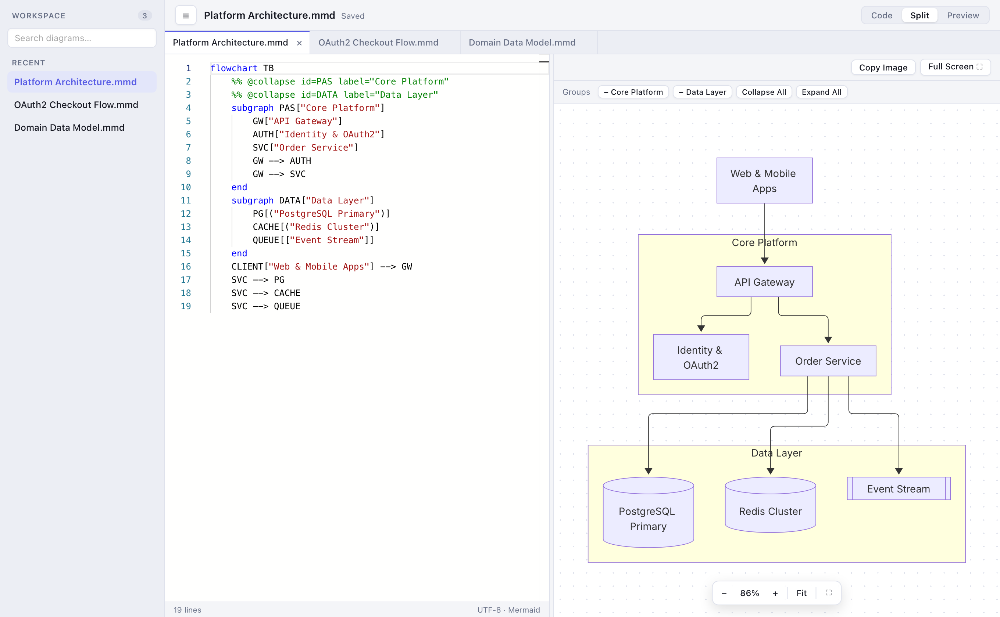
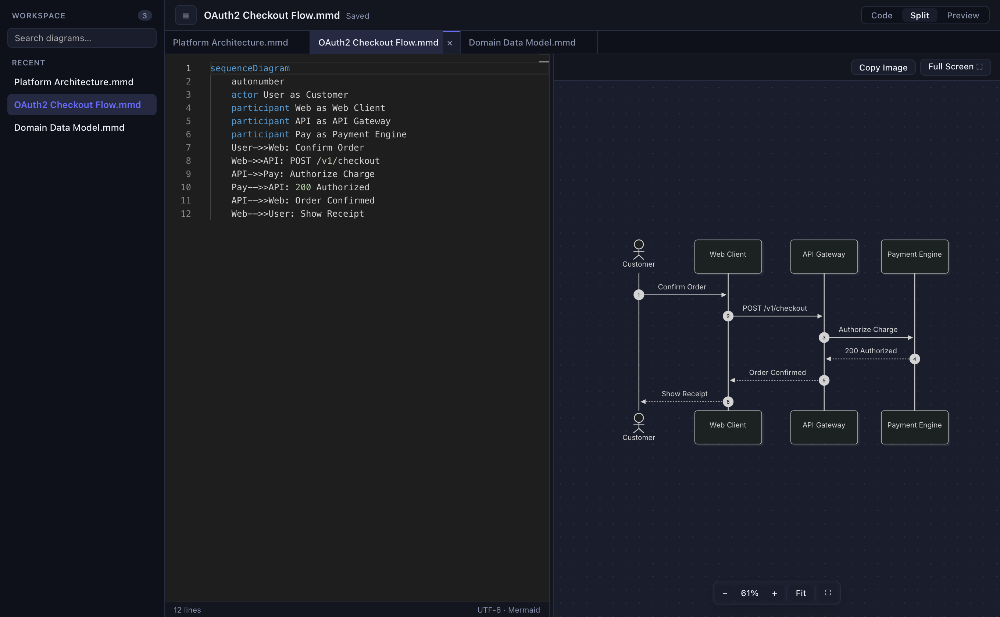
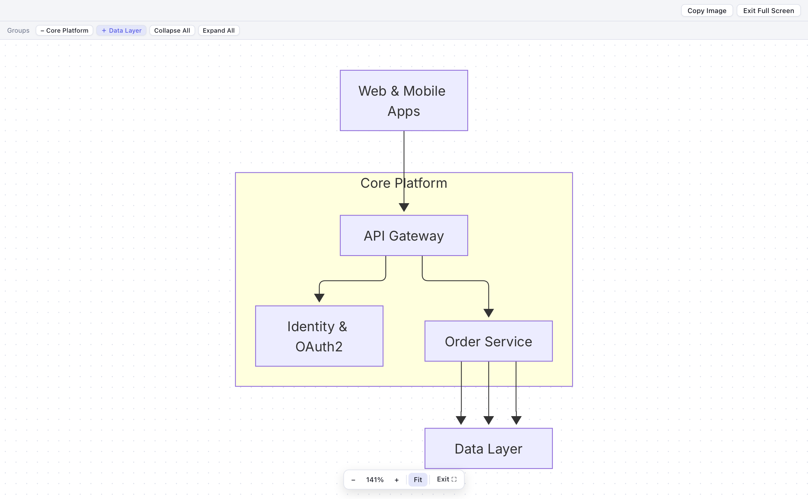
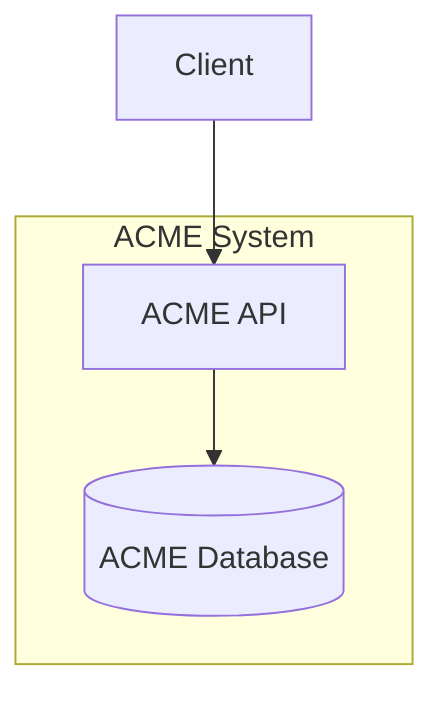

<div align="center">
  

  # Siren

  **Fast, offline-first desktop Mermaid diagram editor for macOS and Windows**

  [](https://v2.tauri.app/)
  [](https://www.rust-lang.org/)
  [](https://react.dev/)
  [](https://www.typescriptlang.org/)
  [](https://microsoft.github.io/monaco-editor/)
  [](https://mermaid.js.org/)
  [](#getting-started)
</div>

---

**Siren** is a local desktop Mermaid diagram editor built with **Tauri 2**, **Rust**, **React**, **TypeScript**, **Monaco Editor**, and official **Mermaid.js**. It works 100% offline with zero accounts, CDNs, remote backends, or telemetry—while keeping your `.mmd` source files completely standard and portable.

## Screenshots

### Light Workspace & Collapsible Flowchart Groups


### Dark Appearance & Multi-Tab Editing


### Full Screen Presentation Mode


## Getting Started

Common prerequisites: Node.js 22.12+ and stable Rust with Cargo. Resolved dependency versions are locked in `package-lock.json` and `src-tauri/Cargo.lock`; use lockfiles in CI as well.

- **macOS:** Xcode Command Line Tools (`xcode-select --install`). Signed distribution packages require an Apple Developer ID certificate and notarization credentials.
- **Windows 10/11:** Visual Studio Build Tools with the **Desktop development with C++** workload, Windows SDK, MSVC Rust toolchain, and Microsoft Edge WebView2 Runtime.
- **Linux:** architecture ready; not yet verified. Requires native Tauri/WebKitGTK dependencies and file dialog libraries.

```sh
npm ci
npm run desktop
```

`npm run dev` starts only the browser preview: it uses `localStorage`, browser downloads, and the Web Clipboard API. It does not replace desktop integration testing.

```sh
npm run build
npm test
cargo test --manifest-path src-tauri/Cargo.toml
npx playwright install chromium webkit
npm run test:e2e
npm audit
```

## Distributable Packages

```sh
# Run on the target platform
npm run tauri -- build
# macOS application bundle only, local debug build
npm run tauri -- build --debug --bundles app
# Windows installer (must run on Windows)
npm run tauri -- build --bundles nsis
```

The Windows installer cannot be built on macOS: without `--target`, Tauri builds for the host platform and produces a macOS (Mach-O) binary, ignoring `--bundles nsis`. Build it on Windows, or let the **Release** GitHub Actions workflow (`.github/workflows/release.yml`) build it: on every push to `main` it publishes a GitHub release with the Windows NSIS installer, the macOS arm64 `.dmg`, SHA-256 checksums, and auto-generated notes.

Output is written to `src-tauri/target/release/bundle/` (or `debug/bundle/`). macOS produces `.app`/`.dmg`; Windows produces NSIS/MSI installers depending on the selected targets. The configuration does not automatically sign or publish packages. Unsigned macOS builds are suitable for local verification; public distribution requires code signing and notarization.

## Usage

- **Native Menu & Shortcuts:**
  - **New (`⌘N` / `Ctrl+N`):** create a new diagram with a custom name.
  - **New from Template (`⇧⌘N` / `Ctrl+Shift+N`):** choose a diagram name and pick a starter template from a dropdown.
  - **Open File (`⌘O` / `Ctrl+O`):** open `.mmd`, `.mermaid`, or `.md` files.
  - **Save (`⌘S` / `Ctrl+S`) & Save As (`⇧⌘S` / `Ctrl+Shift+S`):** save to the workspace or directly to the file on disk; Save As writes a `.mmd` file (or `.mermaid` if specified).
  - **Export (`⌘E` / `Ctrl+E`):** export the diagram to SVG, PNG, or PDF.
  - **Close Tab (`⌘W` / `Ctrl+W`):** close the active tab without quitting the window.
  - **Settings (`⌘,` / `Ctrl+,`):** configure light/dark appearance, default Mermaid theme, preview debounce (100–3000 ms), and workspace autosave.
- **Workspace & Tabs:**
  - The left sidebar lists recent diagrams in your workspace with search by name. Right-click any item to **Rename**, **Duplicate**, **Reveal in Finder / File Explorer**, or **Remove from Workspace** (which removes the item from Siren's workspace without deleting any file on disk).
  - Open diagrams appear as draggable tabs above the editor. Drag tabs to reorder them, double-click or right-click a tab to **Rename**, or click `×` / **Close Tab** to close it.
  - The split ratio between editor and preview, as well as the window size and position, are automatically remembered across restarts.
- **Preview & Full Screen Presentation:**
  - Use the mouse wheel or zoom buttons to zoom, drag to pan, click the percentage to reset to 100%, or click **Fit** to center.
  - Switch between **Code**, **Split**, and **Preview** modes, or click **Full Screen ⛶** to present the diagram across the entire screen (`Esc` to exit).
  - **Invalid edits:** the last valid preview remains visible with a warning banner. Exporting or copying asks for confirmation when the displayed diagram does not match the current source code.

## Workspace Archive & Recovery

A versioned JSON archive suits a personal desktop app with a moderate number of diagrams: human-readable, portable, and free of database services or migrations. Updates are serialized and atomically replace the file via a temporary file on the same filesystem, keeping a backup copy before replacement.

Data location (Tauri `app_data_dir`):

- macOS: `~/Library/Application Support/it.mermaidfree.editor/archive.json`
- Windows: `%APPDATA%\it.mermaidfree.editor\archive.json`
- Linux: `$XDG_DATA_HOME/it.mermaidfree.editor/archive.json` (typically `~/.local/share/...`)

`archive.backup.json` stores the previous version, and `window-state.json` stores the window position and size. Each document includes `id`, `name`, `code` (draft), `savedCode`, `collapsed`, `modified`, `opened`, and—for files on disk—`path` and `externalText`. User preferences, open tabs (`openTabs`), editor split width (`splitRatio`), and active document are stored in the same archive. Data is not encrypted.

Drafts are also journaled in the WebView `localStorage` before the Rust write (debounced by 200 ms). On restart, any pending draft is recovered and notified via a toast. Autosave consolidates local workspace documents after 1.2 seconds; files on disk are only written on explicit **Save**. Quitting with unsaved changes prompts to save all, keep drafts, or cancel.

If both the primary JSON archive and backup are unreadable, the app reports the error and disables automatic writes so both files can be inspected safely.

## Files, Drag & Drop, and OS Integration

Supports `.mmd`, `.mermaid`, and `.md` files (UTF-8, up to 8 MiB per file on desktop). Multiple files open in separate tabs. When importing a Markdown file containing multiple Mermaid blocks, Siren asks which block to import as a workspace copy **without modifying the original Markdown file**. Both backtick and tilde fences with the `mermaid` info string are supported.

Before opening files when the current document has unsaved changes, Siren prompts to **Save**, **Discard**, or **Cancel**. Dragging files onto the window uses native Tauri events with a visual drop overlay; only after dropping does the backend authorize reading those file paths.

File associations for `.mmd` and `.mermaid` are declared with the **Editor** role without forcing Siren as the default handler:

- **macOS:** `RunEvent::Opened` collects file URLs sent from the Dock, Finder, and *Open With*, even before React is ready.
- **Windows:** startup arguments and the single-instance plugin forward file paths to the running instance and bring the window to the front.
- `.md` is not globally associated to avoid interfering with general Markdown editors; open `.md` files via **Open File…** or drag and drop.

When the window regains focus, Siren checks whether the active file on disk has changed; on save, it compares the file on disk against the last known content (`externalText`). If modified or removed externally, overwriting is blocked and you can **Reload File** or **Save As**.

## Mermaid Configuration & Fidelity

Precedence: Mermaid defaults → app settings (`initialize`) → diagram directives/frontmatter, following official Mermaid behavior. Security parameters remain locked. Changing the app appearance does not alter diagram source code or strip frontmatter.

The preview uses official Mermaid inside a Shadow DOM container to isolate diagram SVG and styles from app styles. Inter Latin 400/500/600 is bundled locally and loaded before rendering. `fontFamily` can reference any installed system font; missing fonts fall back to local CSS sans-serif.


Official references: [Mermaid Configuration](https://mermaid.js.org/config/configuration), [securityLevel](https://mermaid.js.org/config/schema-docs/config-properties-securitylevel.html), [Mermaid Live Editor](https://github.com/mermaid-js/mermaid-live-editor), [Tauri Documentation](https://v2.tauri.app/).

## Export & Clipboard

- **SVG:** sanitized original SVG with embedded Inter Regular font, explicit dimensions, and Mermaid styles; remains fully vector. HTML labels (`foreignObject`) require an SVG viewer that supports embedded HTML.
- **PNG:** 1×–4× scale factor, transparent or custom solid background. Capped at 32 megapixels and 16384 px per side to prevent excessive memory allocation.
- **Desktop Clipboard:** raw RGBA pixels written via the Tauri clipboard plugin as a native image compatible with documents, email clients, and presentation tools. Browser preview uses the Web Clipboard API (`image/png`).
- **PDF:** jsPDF + svg2pdf, preserving vector shapes and text where supported; A4 or Letter, Landscape or Portrait, fit-to-page or original dimensions with a 20 pt margin.

PNG, clipboard, and PDF convert `foreignObject` labels into native SVG `<text>`/`<tspan>` elements (preserving line breaks): rich HTML formatting, math, or custom fonts may differ. Exports always use the currently rendered preview (respecting collapsed groups) and prompt for confirmation if the preview is out of date.

## Collapsible Groups



Controls above the preview collapse or expand individual groups or all groups at once. The `collapsed` state is stored separately from the Mermaid source in the workspace archive, so exported `.mmd` files remain standard Mermaid.

[src/lib/groups.ts](src/lib/groups.ts) implements a bounded structural parser tracking nested group stacks, node declarations, edges, and ownership. Edges crossing into a collapsed group are redirected to the outermost collapsed ancestor, while internal edges are hidden in the view projection without mutating the source code.

Supported v1 subset: `flowchart`/`graph` with explicit direction, one statement per line, ASCII alphanumeric IDs with underscores/hyphens, `subgraph ID["Title"]`, delimited node shapes, `:::class` and `classDef`, edges (`-->`, `---`, `<-->`, `-.->`, `==>`, `--o`, `--x`), edge labels (`-->|text|`), and chains. Advanced constructs (`&`, semicolons, `@{...}` shapes, multiline node labels, standalone `style`/`class`/`linkStyle`/`click`) fail closed with a clear message **only when collapsing a group**; standard rendering supports all Mermaid syntax when groups are expanded.

## Security

Mermaid runs with `securityLevel: strict`, sanitized by DOMPurify with clickable links, callbacks, and external images disabled (`script`, `iframe`, `embed`, `object`, `image`, `a`, `href`, and `xlink:href` are forbidden).

Production CSP restricts scripts, fonts, and workers to local assets, images to `'self' data: blob:`, disables frames/objects, and limits connections to local IPC. Backend Rust commands are scoped strictly to the workspace archive and user-authorized file paths.

## Project Structure

```text
src/App.tsx                  UI, tabs, workspace flows, native menu handlers
src/components/Editor.tsx    local Monaco editor and diagnostics
src/components/Preview.tsx   Shadow DOM SVG isolation, crisp zoom, and pan
src/lib/render.ts            Mermaid render queue and DOMPurify sanitization
src/lib/groups.ts            structural flowchart group parser and projection
src/lib/documents.ts         data model, templates, and Markdown import
src/lib/native.ts            persistence and Tauri IPC bridge
src/lib/export.ts            SVG, PNG, PDF export and image clipboard
src-tauri/src/lib.rs         atomic archive, window state, file access, OS menu
tests/                       unit tests and Playwright E2E scenarios
```

## License

Released under the [MIT License](LICENSE).
